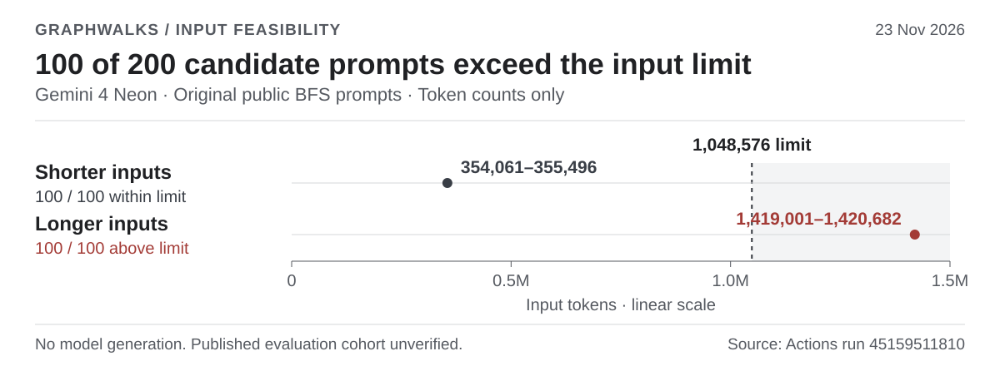

# Model Claim Replay

**Audit AI benchmark claims. Replay the evidence.**

[](https://github.com/fraware/model-claim-replay/actions/workflows/ci.yml)
[](https://www.python.org/downloads/)
[](LICENSE)

[Live explorer](https://fraware.github.io/model-claim-replay/) · [Documentation](docs/README.md) · [Contributing](CONTRIBUTING.md)

Model Claim Replay connects a specific published AI evaluation claim to its source data, execution protocol, task-level results and reproducible scoring. It records what was measured, what was excluded, what the experiment cost to reserve, and where comparison with a publisher's result is blocked.

## Run your first evidence replay

Install from GitHub with Python 3.10+ and Git. The demo needs no API key, model calls or runtime dependencies.

```bash
python -m pip install "git+https://github.com/fraware/model-claim-replay.git"
claim-replay demo
```

Open `.runs/demo/report.html` in your browser. The three-task demo imports fixed responses, recomputes exact-match accuracy, and writes a self-contained HTML report and JSON evidence. Its **2/3 score is synthetic**.

The output directory must be new. For a second run use `claim-replay demo --out .runs/another-demo`.

## Real evidence

Our first investigation examines the public [GraphWalks](https://huggingface.co/datasets/openai/graphwalks) BFS candidate dataset in the context of Google's reported Gemini 4 Neon result.

| Experiment | Measured finding |
|---|---|
| [Gemini token counts](https://fraware.github.io/model-claim-replay/graphwalks.html#provider) | 100/200 public candidate inputs fit; 100/200 exceed the reported input limit. |
| [OpenAI campaign](docs/OPENAI_CAMPAIGN.md#observed-results) | 8/16 graded, 8 context-blocked; recorded mean F1 0.875 on graded tasks. |
| [GPT-6.2 Sol generation](https://fraware.github.io/model-claim-replay/graphwalks.html#openai-result) | One original task, F1 = 1.0; 255,598 input tokens, 572 output tokens. |
| [Deterministic BFS control](docs/GRAPHWALKS_CONTROL.md) | 200/200 tasks scored F1 = 1.0 using graph traversal, with zero model calls. |

[](https://fraware.github.io/model-claim-replay/graphwalks.html)

The GPT-6.2 Sol result has an [original execution archive](evidence/graphwalks/openai-first-generation-2026-11-24/original-actions-artifact.zip) and [offline verification instructions](evidence/graphwalks/openai-first-generation-2026-11-24/README.md). Its disclosed final answer was rescored from the pinned reference. Full-answer extraction, provider execution and invoices are not independently authenticated. The separate [16-task campaign](docs/OPENAI_CAMPAIGN.md#observed-results) completed eight generations: seven disclosed scores were independently recomputed as F1 1.0; the recorded parser failure (F1 0) is withheld from rescoring. Eight longer tasks were blocked. No score is reported for the entire 16-task cohort.

**No publisher aggregate has been reproduced.** The candidate data, model and protocol are insufficient to claim replication of Google's 95.2% Gemini score. Neither OpenAI diagnostic estimates population accuracy.

## What you get

- **Claim manifests:** source URLs, reported metrics, declared conditions and reproduction blockers.
- **Local evidence bundles:** imported responses or explicit model runs, task coverage, SHA-256 commitments and standalone reports.
- **Official harness integration:** import Chartography Inspect AI logs, preserve the recorded scorer and compare compatible task/epoch pairs.
- **GraphWalks tooling:** pinned source audits, token feasibility, budget gates, offline F1 scoring and public-journal verification.

The CLI complements evaluation harnesses such as [Inspect AI](https://inspect.aisi.org.uk/). It focuses on the evidence linking a run to a named public claim.

## Choose your next step

| Goal | Guide |
|---|---|
| Run a local replay, import responses or compare Inspect logs | [Usage](docs/USAGE.md) |
| Inspect or reproduce a measured GraphWalks result | [GraphWalks dossier](docs/GRAPHWALKS.md) · [OpenAI campaign](docs/OPENAI_CAMPAIGN.md) |
| Check a local bundle in your browser | [Evidence checker](https://fraware.github.io/model-claim-replay/check.html) |
| Understand the trust boundary and scoring rules | [Methodology](docs/METHODOLOGY.md) |
| Investigate the registered Chartography claim | [Chartography dossier](docs/CHARTOGRAPHY.md) |
| Add a claim, fix a bug or improve onboarding | [Contributing](CONTRIBUTING.md) |

## Development

```bash
git clone https://github.com/fraware/model-claim-replay.git
cd model-claim-replay
python -m pip install -e .
python -m unittest discover -s tests -v
```

See the [development guide](docs/DEVELOPMENT.md) for integration tests, website testing and automation scope. The project is pre-release; package installation currently uses GitHub. The [roadmap](docs/ROADMAP.md) separates implemented features from planned work.

MIT-licensed code. External benchmarks, models and evaluators retain their own licenses and access conditions. See [security and responsible disclosure](SECURITY.md).
